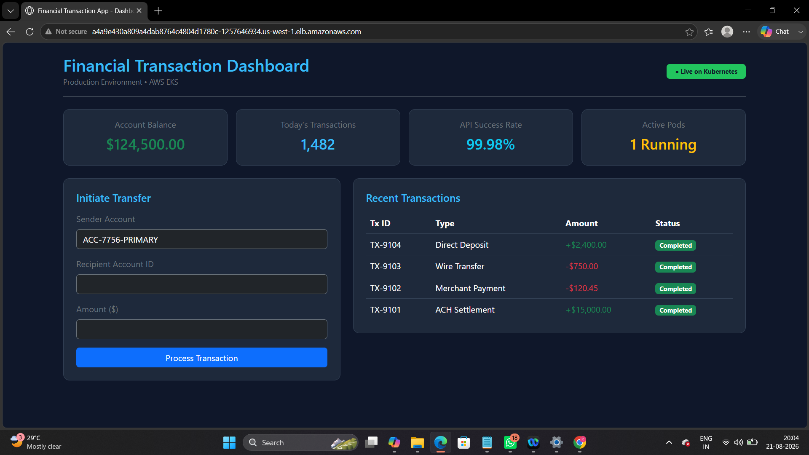
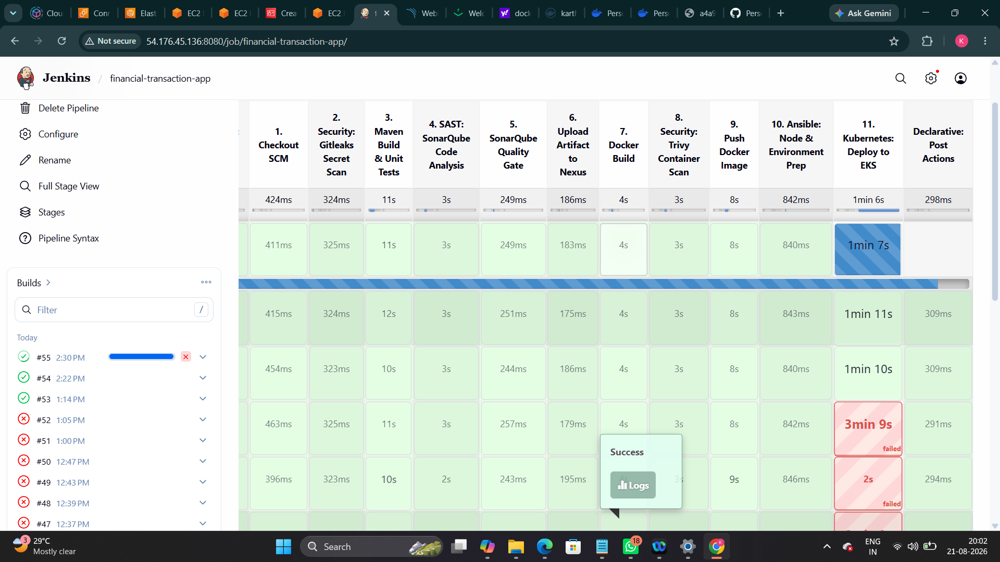

# Financial Transaction Service

A Spring Boot microservice for demo account-to-account transfers, deployed to **AWS EKS** through an automated **11-stage DevSecOps pipeline** built with Jenkins.

> Learning/demo project. It does not process real money.

## Highlights

- REST API for accounts, transfers and transaction history
- Transfer validation: different accounts, existing accounts, minimum amount and sufficient balance
- CI/CD pipeline with secret scanning, static code analysis, quality gate and container vulnerability scanning
- Containerized with Docker and deployed to Kubernetes behind an AWS load balancer

## What This Project Demonstrates

- Building an end-to-end CI/CD pipeline, from a code commit to a live deployment on AWS EKS
- Adding security checks early in the pipeline: secret scanning, static code analysis and container image scanning
- Integrating Jenkins with SonarQube, Nexus, Docker Hub, Ansible and Kubernetes
- Packaging a Java application as a Docker image and running it on Kubernetes behind a load balancer
- Developing a REST API with Spring Boot, JPA and request validation

## Screenshots

**Application running on AWS EKS**



**Jenkins 11-stage pipeline**



## Tech Stack

| Area | Tools |
|---|---|
| Application | Java 17, Spring Boot 3, Spring Data JPA, H2, Maven |
| CI/CD | Jenkins, Ansible |
| Security | Gitleaks, SonarQube, Trivy |
| Artifacts and containers | Nexus, Docker, Docker Hub |
| Cloud and orchestration | AWS (EKS, EC2, ELB), Kubernetes |

## CI/CD Pipeline

| # | Stage | Tool |
|---|---|---|
| 1 | Checkout source | GitHub |
| 2 | Secret scan | Gitleaks |
| 3 | Build and unit tests | Maven |
| 4 | Static code analysis (SAST) | SonarQube |
| 5 | Quality gate | SonarQube |
| 6 | Artifact upload | Nexus |
| 7 | Docker image build | Docker |
| 8 | Image vulnerability scan | Trivy |
| 9 | Push image | Docker Hub |
| 10 | Environment prep | Ansible |
| 11 | Deploy | AWS EKS (LoadBalancer) |

## Quick Start

Requires JDK 17+ and Maven.

```bash
git clone https://github.com/karthik7756/financial-transctions.git
cd financial-transctions
mvn clean package
mvn spring-boot:run
```

The app runs at http://localhost:8080

Run with Docker instead:

```bash
mvn clean package -DskipTests
docker compose up --build -d
```

## API

| Method | Endpoint | Description |
|---|---|---|
| GET | `/api/health` | Service status |
| GET | `/api/accounts` | List accounts |
| GET | `/api/accounts/{accountNumber}` | Get one account |
| POST | `/api/transactions/transfer` | Transfer funds |
| GET | `/api/transactions/history/{accountNumber}` | Transaction history |

Two demo accounts, `100001` and `100002`, are created on first start.

Example transfer:

```bash
curl -X POST http://localhost:8080/api/transactions/transfer \
  -H "Content-Type: application/json" \
  -d '{"fromAccount":"100001","toAccount":"100002","amount":5000}'
```

## Deploy to Kubernetes

```bash
kubectl apply -f k8s/deployment.yaml
kubectl apply -f k8s/service.yaml
kubectl get svc financial-app-service
```

Open the `EXTERNAL-IP` shown in your browser.

## Project Structure

```
├── dashboard.png        Screenshot used in this README
├── jenkins-pipeline.png Screenshot used in this README
├── src/                 Spring Boot application and dashboard page
├── k8s/                 Kubernetes deployment and service
├── ansible/             Cluster verification playbook
├── Jenkinsfile          11-stage pipeline
├── Dockerfile           Container image
└── docker-compose.yml   Local container run
```

## Project Status

The focus of this project is the DevSecOps pipeline and deployment. The dashboard page at `/` is a static preview and is not connected to the API.

## Author

**Karthik Ankenapally**

- LinkedIn: [linkedin.com/in/karthik-ankenapally-117a26257](https://www.linkedin.com/in/karthik-ankenapally-117a26257)
- Email: [karthikanken18@gmail.com](mailto:karthikanken18@gmail.com)
